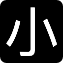
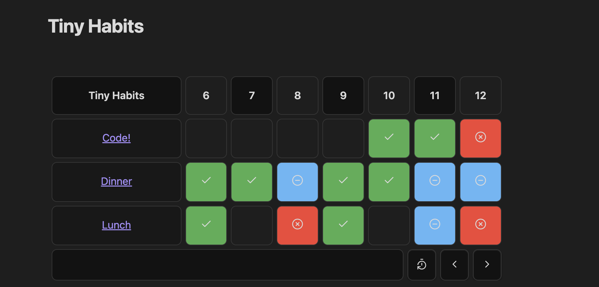

<div id="top"></div>

<!-- PROJECT LOGO -->
<br />
<div align="center">
  <a href="">
    
  </a>

  <h1 align="center">Tiny-Habits</h3>

  <p align="center">
    An Obsidian plugin for keeping track of your habits
    <br />
    <a href="#tiny-habits"><strong>Explore the docs »</strong></a>
    <br />
    <br />
    <a href="">View Demo</a>
    ·
    <a href="https://github.com/nazoadiego/tiny-habits/issues">Report Bug</a>
    ·
    <a href="https://github.com/nazoadiego/tiny-habits/issues">Request Feature</a>
  </p>
</div>

[](https://github.com/nazoadiego/tiny-habits/releases)
[](https://makeapullrequest.com)
[](https://github.com/nazoadiego/tiny-habits/actions/workflows/test.yml)
[](https://github.com/nazoadiego/tiny-habits/actions/workflows/lint.yml)
[](https://www.buymeacoffee.com/nzoadiego)

### Table of Contents

  <ul>
    <li>
      <a href="#tiny-habits">About The Project</a>
    </li>
    <li><a href="#usage">Usage</a></li>
    <li><a href="#options">Options</a></li>
    <li><a href="#how-to-run-it-locally">How to run it locally</a></li>
    <li><a href="#support">Support</a></li>
    <li><a href="#credits">Credits</a></li>
  </ul>


## Tiny Habits

An Obsidian Plugin built with Svelte to track different habits. 

All the entries are stored inside your notes frontmatter. Everything stays local and within your markdown notes.

Features:
- Mark habits as completed, failed, skipped, or not started.
- A table of your habit entries, in the beloved format of a heatmap we see in Github or Anki.
- <a href="#keyboard-support">Keyboard navigation support</a>
- Navigation both to future and past entries.

Preview:



## Usage

- Make a code block with `habits` in the first line
- Open brackets and indicate the folder path. Make sure you write the **full** folder path, otherwise it won't work.
- Create a note in that folder to see the new habit in your habits table.
- Voila!

      ```habits
      {
        "folderPath": "Areas/Habits/Tiny - Morning"
      }
      ```

You can use as many markdown blocks as you like in the same file. And if they get too big, you can collapse them by clicking the table header.

## Keyboard support

You can navigate both with arrows and the hjkl keys. To mark a habit entry, you can do so by focusing on the entry and pressing enter.

To mark an entry with an specific status these are the shortcuts:
- Completed - 1
- Failed - 2
- Skip - 3
- Not started - 4

## Scheduling a habit by weekday

A habit doesn't have to apply every day. Click the calendar button next to a habit's name and pick the weekdays it applies on. The choice is saved in that habit's own note as a `schedule` property, which you can also edit by hand:

```yaml
schedule: [wed]
```

Days outside the schedule show as a paler skip. Nothing is written to the note for them, and you can still mark them like any other day. A habit with no `schedule`, or with none of the weekdays chosen, applies every day. You never have to set one.

## Weekly and monthly habits

A habit doesn't have to come around every day. Click the calendar button next to a habit's name and choose Weekly or Monthly under Repeats. The choice is saved in that habit's own note as an `every` property, which you can also edit by hand:

```yaml
every: week
```

A weekly or monthly habit shows as one wide cell across the days of its week (weeks start on Monday) or its month, with its dates in the corner. Marking it once means you did it for that whole week or month. The entry is stored under the first day of the period, like `2026-11-02: completed` for the week starting Monday, November 2. When the dates on screen cut a period, the cell covers only the days you can see. On a phone it shows the current week or month.

A habit with no `every` property is daily, and the weekday schedule above only applies to daily habits.

## Selecting several entries

Hold Shift and click entries to select them, across any habits and days in the table. Shift+click a selected entry to unselect it. You can also hold Shift and drag over entries to select them all; a drag that starts on a selected entry unselects instead.

From the keyboard, Shift+arrows (or Shift+hjkl) select the entry you are on and the one you move to.

With a selection, every status change applies to all selected entries:
- 1 to 4 set all of them to that status.
- Enter, Space or a click on a selected entry moves all of them to the next status of that entry, so they end up with the same status.

Press Escape to clear the selection. Clicking an entry outside the selection, or moving to other dates, clears it too.

## Options

    ```habits
    {
      "folderPath": "Areas/Habits/Tiny - Morning", // the absolute path to the folder containing your habits
      "displayName": "Morning" // (optional) To customize the name that appears in the table
    }
    ```

## How to run it locally

If you are a developer and you wish to run it locally, follow these steps:

- Clone this repo.
- Make sure your NodeJS is at least v16 (`node --version`).
- `pnpm i` to install dependencies.
- `pnpm run dev` to start compilation in watch mode.

### Running it in a browser, without Obsidian

`pnpm run dev:web` serves the habit tables on http://localhost:5173 with seeded, in-memory habits (they reset on reload). It runs the same code as the plugin; only the host is swapped.

Obsidian sits behind the `Platform` interface in `platform/Platform.ts`. The plugin uses `platform/obsidian/ObsidianPlatform.ts`, and the dev page and tests use `platform/memory/InMemoryPlatform.ts`. Importing `obsidian` anywhere else is a lint error.

### Manually installing the plugin

- Copy over `main.js`, `styles.css`, `manifest.json` to your vault `VaultFolder/.obsidian/plugins/your-plugin-id/`.

### Tests
[](https://github.com/nazoadiego/tiny-habits/actions/workflows/test.yml)

Run with `pnpm run test`

### Linting
[](https://github.com/nazoadiego/tiny-habits/actions/workflows/lint.yml)

Run with `pnpm run lint`

### Making a release

Start from a clean, up-to-date `master` branch and run one of:

```bash
pnpm release patch
pnpm release minor
pnpm release major
pnpm release 1.2.3
```

The command synchronizes `package.json`, `manifest.json` and `versions.json`, builds and validates the plugin, commits the version files, creates an annotated tag, and pushes the commit and tag. GitHub Actions then publishes the GitHub Release automatically with `main.js`, `manifest.json` and `styles.css`. Update `minAppVersion` in the manifest before releasing if the required Obsidian version changes.

The command is safe to retry when the version and tag already point to the same commit. In that case it starts the release repair workflow. It refuses to move a tag that points to another commit.

To only bump the version files without committing, tagging or pushing, run `pnpm version:new <major|minor|patch|x.y.z>`.

To repair a missing release or release asset without making a new version, run:

```bash
gh workflow run release.yml --ref master -f version=1.2.3
```

The repair workflow reuses an existing tag or creates a missing tag from `master` after verifying that the version metadata matches. The generated `main.js` is ignored by Git and is not a release source.

## Support

If you like the extension feel free to buy me a coffee! https://buymeacoffee.com/nzoadiego

Hope this extension makes your life a little easier.

## Credits

Special thanks to zincplusplus https://github.com/zincplusplus/habit-tracker for the original idea, and an extension that I found so useful it motivated me to build my own.

## API Documentation

See https://github.com/obsidianmd/obsidian-api
